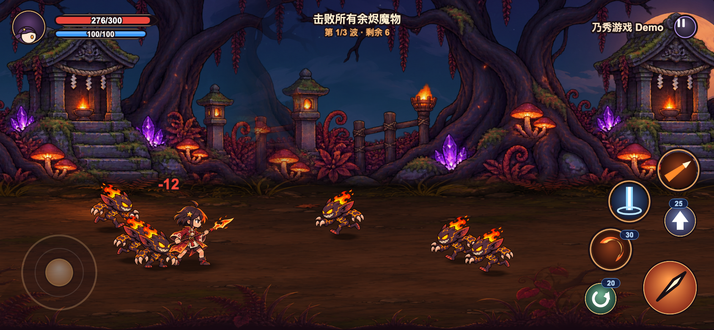

# 烬刃

横屏手机动作试玩。你扮演长枪少女「烬刃·灯」，走进余烬森林，清掉三波魔物，再迎战守墓的灰烬骑士。

这是 **Cocos Creator 3.8.8** 版，代码和资源都在这个仓库里。同一套玩法还有一份 [Godot 版](https://github.com/ctop007/ember-blade-godot)。两个演示都开源，用来看看 AI 能不能把一款能玩的游戏写出来。实机录像会另外放出。



## 现在就玩

可玩包在 **[v0.3.0 Release](https://github.com/ctop007/ember-blade-cocos/releases/tag/v0.3.0)**。不用安装 Cocos。

**Android** — 下载 [ember-blade-cocos-android.apk](https://github.com/ctop007/ember-blade-cocos/releases/download/v0.3.0/ember-blade-cocos-android.apk)（arm64，调试签名）。允许安装未知来源后横屏打开。

**网页** — 下载 [ember-blade-cocos-web.zip](https://github.com/ctop007/ember-blade-cocos/releases/download/v0.3.0/ember-blade-cocos-web.zip)，解压后在该目录起一个静态服务器：

```bash
unzip ember-blade-cocos-web.zip -d ember-web
cd ember-web
python3 -m http.server 8942
```

用浏览器打开 <http://127.0.0.1:8942/>。手机横屏体验最接近真机；在电脑上可以把窗口拉成横屏，或打开设备模拟。

## 怎么操作

- 按住左半屏，摇杆会出现，角色可以前后走动，也有纵深。
- 点按普攻打出三段连击，按住则蓄力突刺。
- 闪避有短暂无敌。跳跃后在空中再按一次，会下劈。
- 三个技能是炎月斩、天穹落光、流星枪。怒气攒满后可以放「烬灭·星陨」。
- 每一波结束会发三张牌，选一张强化，然后再打下一波。第三波之后是 Boss。

在电脑键盘上：`WASD` 或方向键移动，`J` 普攻，`K` 跳跃，`L` 闪避，`U` `I` `O` 三个技能，`P` 大招。画面上没有这些按键提示。

## 两条引擎，一套玩法

| | 本仓库 | 姊妹仓库 |
| --- | --- | --- |
| 引擎 | Cocos Creator 3.8.8 | [Godot 4](https://github.com/ctop007/ember-blade-godot) |
| 试玩包 | [v0.3.0](https://github.com/ctop007/ember-blade-cocos/releases/tag/v0.3.0) | [v0.3.0](https://github.com/ctop007/ember-blade-godot/releases/tag/v0.3.0) |

数值、关卡和操作是对齐的，方便并排试玩。

## 从源码构建

需要本机已安装 Cocos Creator 3.8.8。构建前先关掉正在打开本项目的编辑器，否则会抢项目锁。

网页版：

```bash
/Applications/Cocos/Creator/3.8.8/CocosCreator.app/Contents/MacOS/CocosCreator \
  --project "$PWD" --build "platform=web-mobile"
python3 -m http.server 8942 -d build/web-mobile
```

这条命令构建成功时，退出码是 36。产物在 `build/web-mobile/`（该目录不进 Git）。

Android 调试包（只要 arm64）：

```bash
./tools/build-android.sh
```

脚本里的 JDK、Android SDK 路径是作者本机的 macOS 路径，换电脑要先改。Cocos 会先生成 `build/android/proj`，脚本再调用 Gradle 打出 APK。

## 仓库地图

- `assets/scripts/core/` — 战斗逻辑，不依赖引擎，可以用 `tools/sim.ts` 无头跑一局。
- `assets/scripts/view/` — 画面、特效、界面和触摸。
- `assets/scripts/animation/` — 骨骼播放、刀光和动作衔接。
- `assets/resources/` — 已同步进来的配置、立绘和骨骼。上游若有更新，用 `node tools/sync-assets.mjs`。
- `tools/` — 试玩脚本、性能采样和 Android 构建。

## 本地验收

先把网页版跑在 8942 端口，然后：

```bash
cd tools && npm i
node play.mjs 844 390     # 真实多点触摸打完一局
node perf.mjs 844 390     # 首屏和帧率
```

`WIN=1 node play.mjs 844 390` 会让角色无敌，用来走通胜利结算。地址加上 `?debug` 会挂上 `window.__AI_BRIDGE__`，给自动化脚本用。`?rig=0` 切回旧的单图角色，方便和骨骼动画对照。

性能对照表、骨骼实现和打包时踩过的坑记在 [ENGINE_NOTES.md](ENGINE_NOTES.md)。
